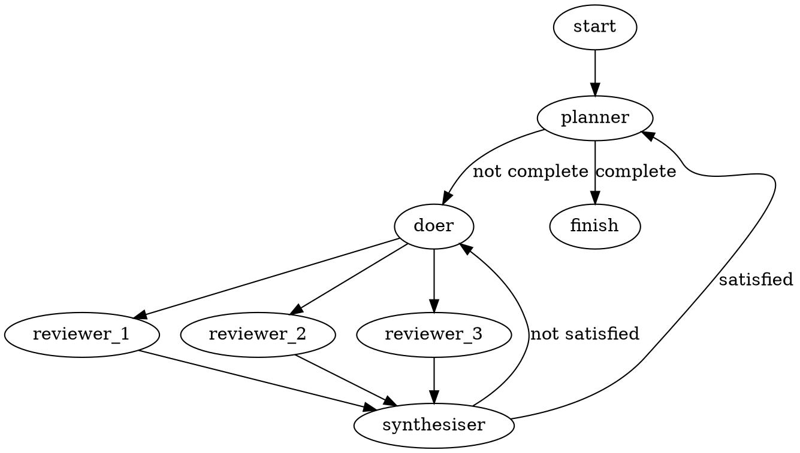

# Iteration 5: fan out

A machine with multiple unlabelled outgoing edges runs all their destinations
concurrently. Each branch must have exactly one unlabelled edge to the same
joining machine. The join runs once after all branches return JSON objects.
A failed process or unreadable result cancels the other branches and stops the
run before any join or work commit.

For example, save this as `<target>/.assembly-lines/three-brains.dot`:



Keep the target's planner and doer configurations. Add folders for the three
reviewers and synthesiser in `.assembly-lines/.machines/`, each containing
`config.json`. A reviewer configuration is:

```json
{
  "role": "validator",
  "lens": "testability",
  "instructions": "Review the current task. Report satisfied and findings; the synthesiser decides whether the attempt is acceptable."
}
```

Use the same instructions and lens for all three reviewers. To compare three
providers, add `"provider"` and `"model"` to each reviewer's configuration,
choosing a different provider and an available model for each. `pi --list-models`
shows available models. Provider selection requires a model in Pi. Without
these fields the machine uses Pi's defaults. A custom `"harness"` can also
select another executable. The factory forwards provider and model as CLI
arguments; they do not change the review prompt.

Configure the synthesiser with:

```json
{
  "role": "validator",
  "instructions": "Decide whether the current attempt is acceptable from the branch reports alone. Return satisfied as a boolean and findings as an array of actionable strings."
}
```

The synthesiser receives a JSON object mapping branch names to their results.
It receives no seed path, plan path or work diff. Its findings go back to the
doer on retry; raw reviewer reports do not. Branches can also have different
instructions or roles: concurrent execution does not require identical jobs.

After configuring a target, run from the repository root (replace `<target>`):

```sh
bin/factory --check-line --target <target> --line three-brains
bin/factory --run tetris-five --target <target> --line three-brains --seed tetris/spec.md
```

The second command uses real agents and needs authenticated Pi providers.
Use a fresh run name because an existing run's settings cannot change.

For the automated demo, run `./test` from `factory/`. The fan-out examples
check concurrent reviewers, identical prompts, results-only synthesis,
retries, malformed graphs and failed branches. Additional regressions keep
siblings blocked on IPC until failure cancels them, and check each branch's
own instructions, harness and model arguments. Test doubles live outside the
factory. `FACTORY_MACHINE` identifies each invocation to custom harnesses
without making otherwise identical reviewer prompts different.

Real-agent examples remain manual integration work; their bindings are not
implemented. `./test --real-agent` selects them explicitly.
